<div align="center">
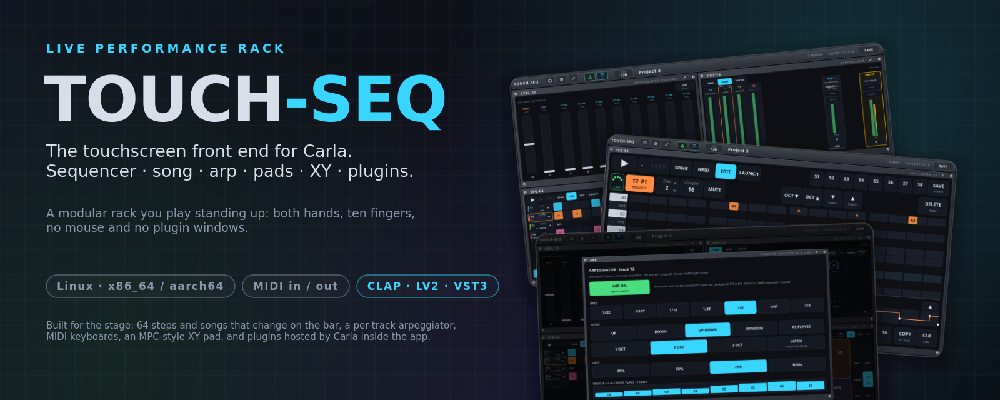
</div>

# TOUCH-SEQ

<div align="center">

**Your plugins. Your fingers. No laptop face.**

A touchscreen live-performance front end for [Carla](https://github.com/falkTX/Carla).
A step sequencer with songs, an arpeggiator, a piano roll with fine automation, chord and drum pads, an
XY effects pad, MIDI keyboards and a touch-first plugin host — one modular rack, built to be played with
both hands.

[](https://github.com/marcin-koziol/touch-seq/releases)
[](https://github.com/marcin-koziol/touch-seq/actions)
[](LICENSE)
[](#install)

**[Download](#install)** · **[Manual](#the-manual)** · **[Less obvious things](#less-obvious-things)** · **[From source](#running-from-source)**

</div>

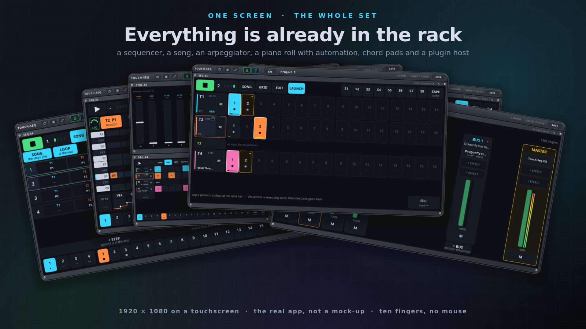

## Why it exists

Most live sets are a laptop, a mouse and fourteen plugin windows. This is the other thing: every module of
the set on **one screen**, sized for fingers, so you can play standing up, look at the crowd instead of a
cursor, and change the arrangement **on the bar** instead of on the downbeat of a mistake.

- **Play it, don't point at it.** Multi-touch modules, hold-then-drag for anything destructive, no tiny
  window furniture. A mouse works too — it is just less fun.
- **Your plugins, not ours.** Carla hosts CLAP, LV2 and VST3 inside the app: per-track chains, effect
  buses, a mixer with real metering, and a patchbay made of cables you draw with a tap. Plugin GUIs open
  in their own windows only if you ask them to.
- **Built for the stage.** Pattern and song changes quantized to the bar, a count-in on the metronome, MIDI
  clock from the keyboard, an arpeggiator locked to the transport, autosave every couple of seconds.
  A show is not a good time to remember Ctrl+S.

## What's in the rack

| module | in one breath |
|---|---|
| **[SEQ-64](#seq-64--step-sequencer)** | 64 steps, 16 patterns, 8 scenes, four track kinds, a polyphonic piano roll and controller lanes finer than the steps |
| **[SONG](#seq-64--step-sequencer)** | the arrangement: a list of steps with bars × repeats and a pattern per track, switched on the bar |
| **[LAUNCH](#launch--every-pattern-at-once)** | every track's patterns as pads, and transitions that play once and go back |
| **[PLAY-12](#play-12--live-play)** | chord pads with voice leading, a keyboard, drum pads, REC/OVR and a per-track arpeggiator |
| **[HOST-4](#host-4--plugins-carla)** | Carla in the app: chains, buses, the mixer, plugin GUIs and the built-in EQ, Space, XYFX, Acid and Sampler |
| **[CTRL-10](#ctrl-10--performance-faders)** | pitch, mod and 8 faders aimed at a track, a channel or a plugin parameter |
| **[PATCHBAY](#patchbay--audio-routing)** | every audio port on the machine, linked with a tap per cable |
| **TOP BAR** | FILE, SETTINGS, PATCHBAY, CLICK, COUNT-in, BPM and SAVE — icons, because words are wide |

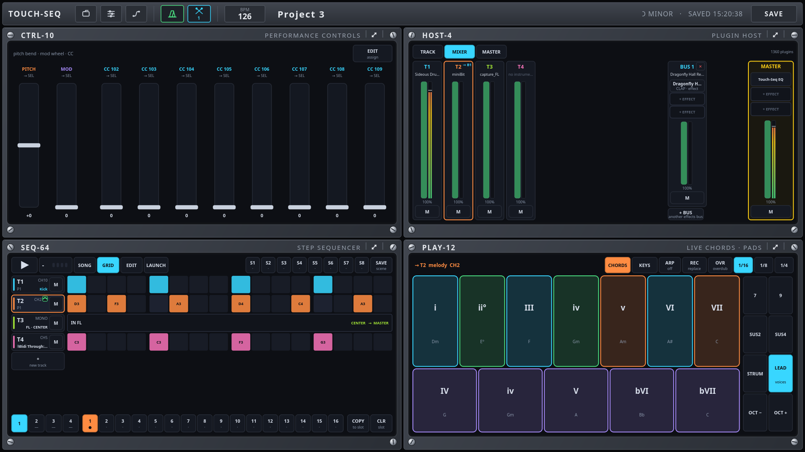

## New in 0.12.0

- **Acid** — our 303-style bass (`acid/`): the **Open303** engine (Robin Schmidt's, the one jc303 uses),
  with a saw/square oscillator, the TeeBee ladder filter, Cutoff / Reso / Env Mod / Decay, Accent, Slide and
  an **Overdrive switch** (jc303's BYOD neural TS808 model). Monophonic, last-note priority, and no window of
  its own: HOST-4 shows its **OSC / FILTER / AMP** knobs, and the **UI** button is gone for our own plugins.
  Pick it in slot 0 of a melody track and let it scream.
- **Sampler** — our 16-pad MPC-style sampler (`sampler/`): **LOAD** a WAV (or let ffmpeg convert another
  format), see its waveform (pan, **+ / − / FIT**, pinch), tap to add chop markers, **CHOP** into 16 slices,
  select a pad and **TO PAD** a slice. **COPY** then a tap on another pad puts the same slice there, so one
  chop can sit on several pads — each with its own **PITCH** (the copy starts at the source's pitch and keeps
  the target pad's note as its root, so it sounds identical until you change it). The pads use the same fixed
  colors as the drum voices. Each pad has Gain (up to 4×), Pan, Pitch, Loop, Reverse and **Gate** (play while
  held vs one-shot) and a **GRP** playback group: pads in the same group cut each other, like MONO for that
  group. **MONO** cuts the previous pad when a new one starts. **PITCH** moves at 12 px per semitone and snaps
  to a whole semitone on release; **STRETCH** shifts the pitch without changing the slice's length (a granular
  shift, not resampling). **STOP** silences every voice. **ADSR** turns the waveform into the amp or filter
  envelope editor: the slice's waveform is a dim ghost behind the curve. The times are fractions of the slice,
  so lengthening the slice stretches the envelope with it; a reversed pad mirrors the envelope, so it fires
  from the slice's end. **TRIGGER** holds the pad for auditioning, exactly like tapping it, and the filter tab
  also has **Cutoff**, **Reso** and the envelope depth. The third tab is an **LFO**: SINE/TRI/SQUARE/SAW,
  0.05–20 Hz, depth and a target — AMP (tremolo), FILTER (±2 octaves) or PITCH (±2 semitones); it retriggers
  with every note. The editor's pads play while held, like PLAY-12's, so
  GATE and LOOP are heard; dragging the slice handles or the **↔** bar updates a held loop as you drag, with no
  gap. **LOCATE** centres the waveform on the selected pad's slice, zoomed so it fills about a third of the
  view. **PRESETS**
  keeps the pads and their samples on the machine (`~/.local/share/touch-seq/sampler-presets/`), so deleting
  a track — or the whole project — does not lose them; SAVE asks for a name on an on-screen keyboard, tap a
  preset to load it, hold its ✕ to delete it. A long sample is read in the background, with a spinner over
  the waveform, so the panel stays responsive; while a pad plays, a green **playhead** runs through its slice.
  PLAY-12 shows the sampler's pads
  (notes 36–51) instead of the keyboard, so a melody track becomes a pad track. On a **drum** track the pads
  play, but only those whose note is one of the 12 kit voices are written into the pattern (the others have
  no voice to sit on); use a melody track to record all 16. Samples and the pad map live
  in the project's `.plugins/sampler/` folder and travel with the project.
- the preset fix from 0.11.2 stays: a third-party plugin's own state is not overridden by a sidecar, and a
  change the plugin makes itself marks the state for saving.
- `TOUCHSEQ_PARAM_LOG=params.log` logs every parameter write with its source (knob, fader, tempo, restore,
  plugin), for finding what writes what.

0.11.2 fixed presets being overwritten and plugin states not being saved promptly. 0.11.1 brought
**HOST-4 knob sections** (OSC, ENVELOPE, FILTER… in boxes, numbered sequences as vertical bars), a level
meter on every track row, and the MIDI socket at the foot of the channel column. 0.11.0 brought **LAUNCH** —
every track's patterns as pads, with **FILL** transitions that play once and go back. 0.10 brought the
**arpeggiator** —
per track, on the transport's grid, non-destructive — the click kept out of the plugin browser, and `CHN` in
the sequencer. 0.9 brought the dense CC automation (points every ¼ step, sent between the engine's ticks),
the lane-only view with the notes as a ghost, **Space**, and **BUILTIN** in the browser. The
[release notes](https://github.com/marcin-koziol/touch-seq/releases) have every version.

## The manual

The window is a 2×2 rack under a toolbar of **icons**: the folder is **FILE** (projects), the sliders
**SETTINGS** (key/scale and audio output), the cable **PATCHBAY** (audio routing); then, past a line, the
metronome (**CLICK**), the drumsticks (**COUNT**-in) and the **BPM**; on the right **SAVE**, which lights up
while there is something unsaved (the time next to it is the last save of anything, project or plugin).
**⤢** on a module's rail blows it up to full screen; everything else keeps running.

### SEQ-64 — step sequencer

- any number of **melody**, **drum**, **external MIDI** and **audio** tracks; **+** adds one (the dialog picks
  the kind, and for external the MIDI output it sends to, for audio the interface input it takes)
- 16 patterns per track, 1–96 steps (polymetric tracks are fine), 8 **scenes**
- the top bar's grid button switches the whole project between **1/16**, **1/8T**, **1/16T** and **1/32**:
  pattern lengths, song bars, the metronome and the recording quantize follow it (changing it stops the
  transport, so start again on the new grid)
- pattern and scene changes are **quantized to the bar**: the current pattern plays to the end of the bar
- rows are **yours to order**: hold a track's header for a moment, then drag it up or down — the track keeps its
  number and colour, and the same works for the steps of a song (hold a step, drag it in the list)
- **SONG** is the arrangement above the patterns: a list of steps, each lasting 1–16 bars (×1–8 repeats) and
  saying which pattern every track plays in it — a track left as **—** keeps what it was playing, so a step
  can change just one part. Tap a step to play it from the next bar, tap its bars or ×repeats to change them,
  hold **✕** to delete, **+ STEP** appends one; the **SONG** button switches the transport between following
  the song and playing the patterns you pick by hand
- the top bar carries the transport's own settings, apart from the app's buttons (FILE, SETTINGS, PATCHBAY
  are icons; a line, then the metronome's **CLICK**, the **COUNT**-in of 0/1/2 bars — the count-in plays its
  clicks first and the pattern starts on the downbeat after them — and the **BPM**, which opens the tempo)
- **GRID** shows all tracks; **EDIT** opens the selected one:
  - melody: a **polyphonic piano roll** with a velocity/gate lane; notes can be stretched over several steps
    (as long as the pattern — a 64-step pattern holds a four-bar pad) and are recorded as long as you hold
    them; rows outside the project's scale are dimmed
  - under the roll a **lane** edits what you point it at: **VEL** (velocity), **GATE** (length) or a
    **controller lane** — **+ CC** adds one (CC1 mod, CC7 volume, CC74 cutoff, … up to four per pattern).
    Drag across it to draw; a quick drag fills the points it crossed, so a diagonal is a ramp. Points are
    **not stuck to the steps**: they sit as fine as a quarter of a step (1/64 with 1/16 steps) and the engine
    sends the lane between its ticks, so a sweep moves smoothly; a value holds until its next point and only
    changes are sent. The **▼ / ▲** chevron at the lane's right hides the piano roll and gives the lane the
    whole panel for drawing (the notes stay as a faint grey ghost, so there is something to draw against). With
    REC/OVR armed a controller from the track's MIDI keyboard — or a CTRL-10 fader on its channel — is written
    under the playhead (a lane is made for it when there is none), and the lanes play with the pattern
  - drums: a voice × step matrix, voices in fixed colors (kick red, snare orange, hats yellow, …);
    **STEP** paints hits, **VEL** drags velocity and **GATE** sets a step's length: drag sideways to stretch
    it over the following cells exactly like a note in the piano roll (an empty cell makes the step and
    stretches it in one move), or up/down for the value. The white bar runs across the cells it covers, with
    a cyan handle at its end; a tap on a step takes it out. Lengths are in grid steps, so a 1/16T grid can
    hold fast rolls, and a step never runs into the next hit of the same voice
  - external MIDI: the same piano roll, but the track has **no plugins**: its notes, velocity, gate and the
    faders go straight out to the chosen hardware output (and nowhere else), and its header shows the port
  - audio: an **interface input** (a mono capture port, e.g. the UMC404HD's FL) with **L / C / R** panning —
    the one track kind with no MIDI at all. It is patched by the rack, so it survives chain changes: its input
    goes through the track's effects (HOST-4) and on into its bus or the master, and that is how a synth
    plugged into an input is heard through the master's reverb
- every MIDI track (melody, drum, external) can play and record from its **own MIDI keyboard**: the socket
  at the left of its EDIT header opens a dialog with the system's MIDI inputs and a channel (**ALL** or 1–16,
  so one keyboard can drive several tracks on different channels). The socket is **green with the channel**
  once configured, **amber** when that device is away, dim when the track only plays its patterns (its row in
  GRID shows the same socket, small, so you can see which tracks have a keyboard from there — it sits under
  the track's channel, and beside the **M** a small **level meter** shows what the chain is doing). Incoming
  notes play the track's instrument (or its hardware output), light its pads/keys in PLAY-12 and are recorded
  when REC/OVR is armed — quantized like the on-screen pads, into the track the keyboard is routed to (which
  need not be the selected one). Pitch bend and the mod wheel reach the instrument too. A note keeps the
  length you held it for, over the bar line included
- the same keyboard is the **transport**: its play/stop buttons start and stop the sequencer (MIDI
  Start/Continue/Stop, or CC 115/116), and its **clock** sets the tempo — 24 pulses per beat, smoothed, so
  the project runs at the keyboard's bpm
- in EDIT, **▼ trans / ▲ trans** moves the whole pattern one scale degree down or up: the step comes from the
  project's key and scale, so the pattern stays in key (a chromatic note keeps its alteration, octaves wrap);
  drum tracks have fixed voices and don't offer it

| | |
|---|---|
| 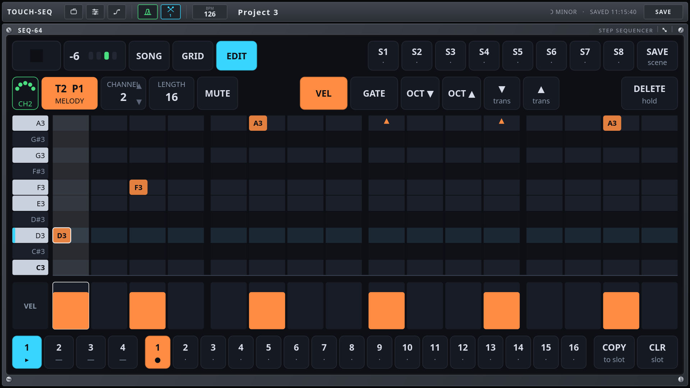 | 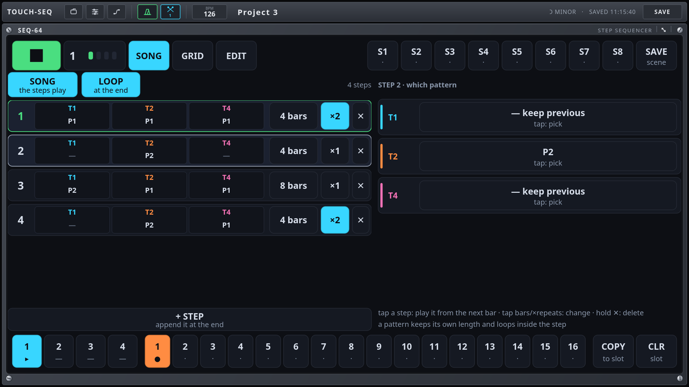 |
| 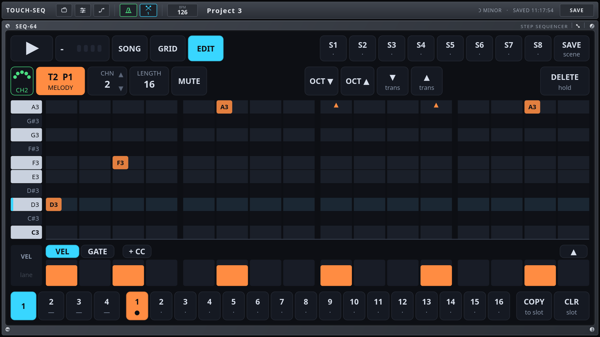 | 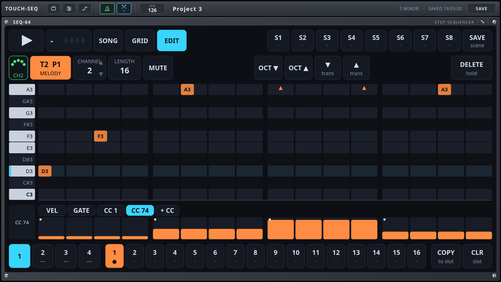 |
| 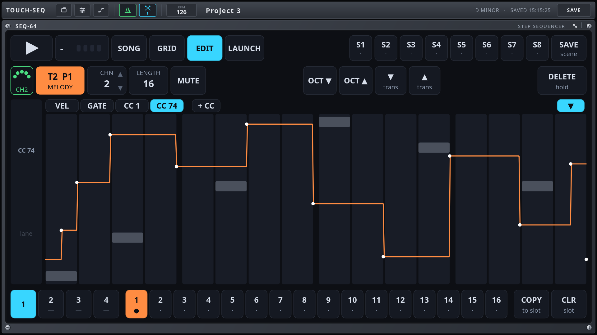 | 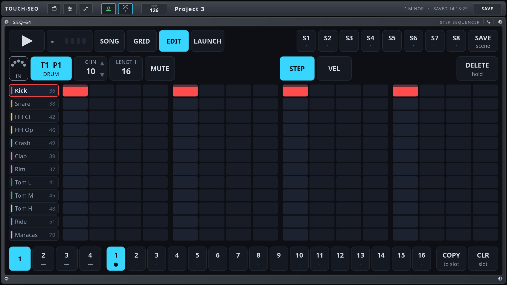 |
| 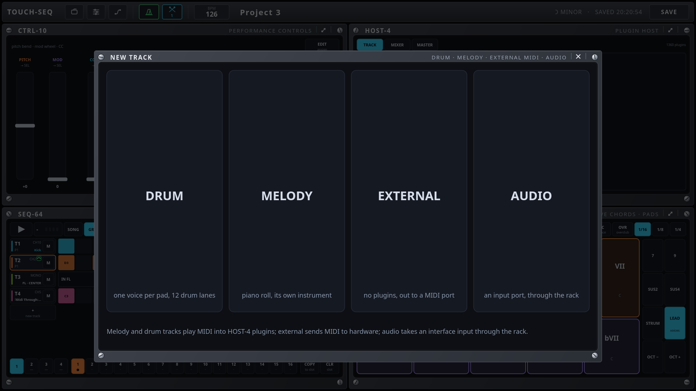 | 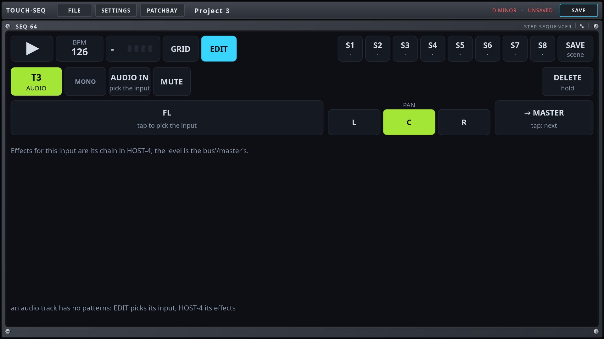 |
| 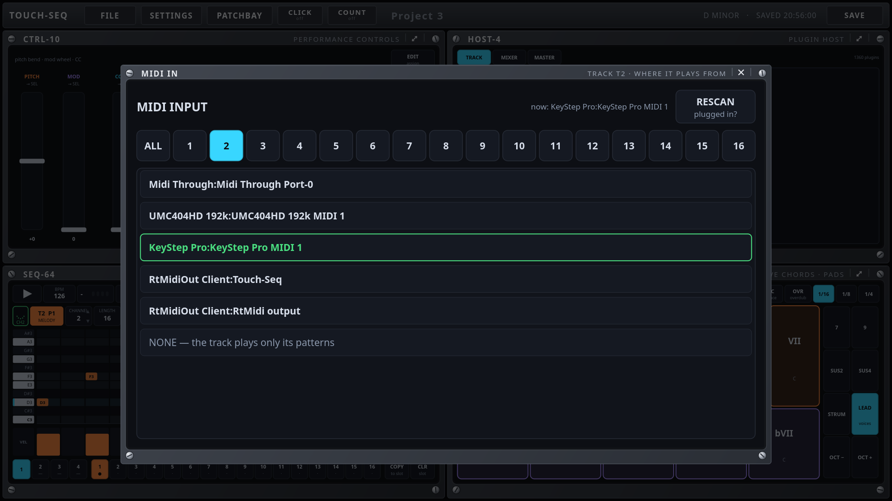 | |

### LAUNCH — every pattern at once

A pad per pattern and track, all of them on one screen: tap one and that track plays it at the next bar
(tapping a pad also picks the track, so PLAY-12 follows). The playing pad is filled with the track's
colour, a queued one blinks, and an empty pattern is a rest you can launch. The playing pad also carries a
thin progress line — how far through its pattern the track is; a transition's line is amber and drains over
the bars it has left.

**FILL** marks the amber **→** patterns: transitions. Launched live, a transition plays its own length in
whole bars (a 16-step pattern is one bar, a 32-step one two) and then the track returns to what it was
playing — a fill for the drums, a turnaround for the keys. Chaining two transitions keeps the original way
back; tapping any other pattern cancels it. With **SONG** on nothing is blocked: a step's pattern wins over
a transition's return, and a track the step leaves as **—** gets its transition back after its bars.

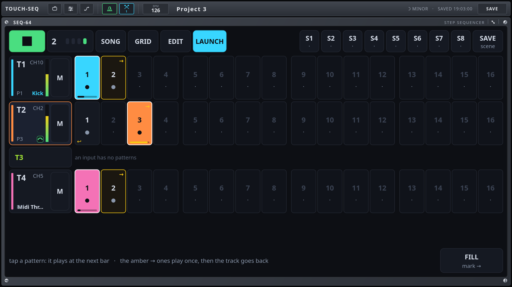

### EQ — eight bands, drawn in the app

Touch-Seq EQ is our own CLAP/LV2 plugin (`eq/`) with **no window of its own**: pick it in a chain and HOST-4's
parameter area becomes its editor. Eight bands on a log frequency axis with the summed curve and the plugin's
**spectrum** behind it: drag a dot for frequency (sideways) and boost/cut (up and down), tap an empty spot to
put the chosen band there — near the bass end it becomes a **low cut**, near the top a **high cut**, in the
middle a bell — and the menu underneath sets its **mode** (bell, low/high shelf, low/high cut) and **width**.
The spectrum is measured in the plugin and read back through output parameters, because Touch-Seq has no audio
buffers of its own; the curve is drawn from the same biquad maths the plugin runs.

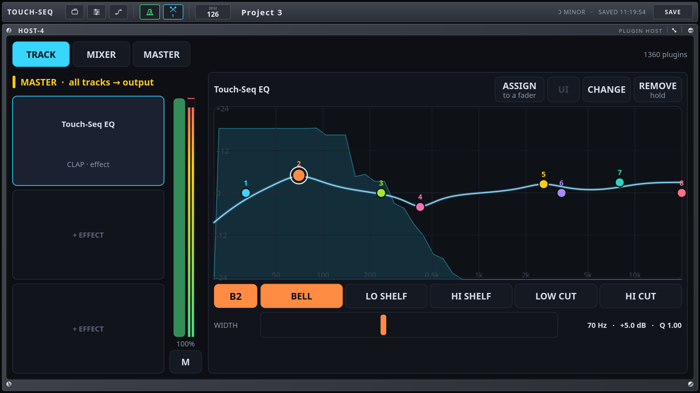

### HOST-4 — plugins (Carla)

Carla runs inside the app's process as a JACK client named **Touch-Seq**, and every plugin gets a client of
its own under that name ("Touch-Seq/T1.1 Surge XT"); the audio links are built from those names. Two engines
with one name would make Carla rename one ("Touch-Seq.173/…") and every link the app builds would then fail —
silence, while the app looks fine. So a second Touch-Seq (or one still closing after a project switch) takes
the first free name (*Touch-Seq 2*, …) and says so in HOST-4's status line: both keep playing.

- every plugin track has a chain: **instrument → 2 effects → level/mute**; all tracks go through the
  **MASTER** (3 effects, e.g. a global reverb) to the audio output. **External MIDI** tracks have no chain at
  all — the panel shows their output port instead, with **MIDI OUT** to change it
- **audio tracks** have a chain too (slot 0 is an effect, not an instrument): the input is patched into it, so
  effects and the fader work as soon as there is one. A track with no effects gets **Touch-Seq Monitor**, a
  transparent gain/pan node (`monitor/` in this repo, built like XYFX) — it is what gives a bare input a
  level to meter and a fader to set; remove it and the input is a plain patch again (no meter, no fader).
  The **metronome** is the same idea the other way round: `click/` sits between the master and the output and
  plays a click for every beat note the sequencer sends it
- **Space** is our delay-and-reverb in one (`space/`): a stereo delay with a lowpass in its loop and a
  ping-pong cross-feed, into a reverb (eight damped combs, four allpasses a side), with Mix, Reverb, Size,
  Damp, Delay, Time, Feedback and Tone as knobs. **Sync** + **Note** make the delay follow the tempo
  (1/32 … 1/2, triplets too) — and since the project's tempo follows the keyboard's clock, that is a
  MIDI-synced delay; the two effects a live set always needs, without hunting
  for a plugin. **BUILTIN** in the browser lists our own (XYFX, EQ, Space, Acid) first, and they come first
  in **ALL**; the two the app puts in place itself — the monitor and the click — are not offered there,
  because there is nothing to add by hand
- **Acid** is our 303-style bass (`acid/`): the **Open303** engine (MIT, the one jc303 uses) — saw/square,
  the TeeBee ladder filter with Cutoff, Reso, Env Mod and Decay, then Accent, Slide and an **Overdrive
  switch** (jc303's BYOD neural TS808 model). It is monophonic with last-note priority, so overlapping notes
  slide; velocity 100 and up triggers the accent, as on the 303. It has **no window of its own** — HOST-4
  shows its OSC, FILTER and AMP knobs, and the **UI** button is hidden for our own plugins. Pick it in slot 0
  of a melody track; it is a synth, not an effect
- **Sampler** is our MPC-style pad sampler (`sampler/`): a waveform with chop markers, 16 pads, and
  Gain / Pan / Pitch / Loop / Reverse for the selected pad. **LOAD** imports a file into the project's
  `.plugins/sampler/` folder (WAV directly; ffmpeg converts other formats), **CHOP** makes 16 equal slices,
  a tap on the waveform adds a marker, and **TO PAD** puts the selected slice on the selected pad. **COPY**
  and then a tap on another pad copies the slice there (same file and range, the target's own note as root),
  so the two pads can play the same chop at different **PITCH**es. The
  waveform pans, zooms (buttons, pinch, **FIT**, and **LOCATE** to centre the selected slice at about a third
  of the view) and its white handles resize a pad's slice while the white
  **↔** bar moves the whole slice. Each pad has Gain (up to 4×), Pan, Pitch, Loop, Reverse and **Gate** and a **GRP**
  playback group: pads in the same group cut each other; the pads take the drum voices' fixed colors.
  **MONO** cuts the previous pad when a new one starts; **STRETCH** shifts the pitch without changing the
  length, and **STOP** silences every voice. **ADSR** draws the amp/filter envelope over the slice's ghost,
  scaled to the slice (so it stretches when the slice does; a reversed pad mirrors it) with a **TRIGGER** to
  audition; the filter tab adds a low-pass with Cutoff, Reso and envelope depth. The **LFO** tab has the same
  four waves, rate, depth and an AMP/FILTER/PITCH target. The editor's pads play while held, so GATE/LOOP work as in
  PLAY-12, and slice edits are heard on a held loop as it is dragged. **PRESETS** saves the pads and the
  samples they use on the machine (not in the project's plugin folder): a track or project deleted later
  leaves the preset intact, and one preset can be loaded into another project; SAVE asks for the name on the
  on-screen keyboard. A long sample is read in the background (the waveform shows a spinner meanwhile), and a
  green **playhead** runs through the playing pad's slice. The sampler has **no window of its own**; its editor
  is HOST-4's parameter area, and PLAY-12 shows its pads
  (notes 36–51) when the selected track's instrument is the sampler
- **effects buses**: a track's chain can go into a bus instead of straight into the master — **→ MASTER** under
  the chain cycles through the buses, **+ BUS** makes a new one. A bus has its own 3 slots and its own level,
  so one reverb can process just the two of five tracks you route into it; buses are their own columns in the
  MIXER and boxes in the PATCHBAY (`BUS 1 · Reverb`), so an interface's input can be patched through one too
- **TRACK** view: the chain of the track selected in the sequencer (or of the bus you tapped in the mixer) and
  the plugin's parameters as knobs, colored by what they are (filter, envelope, LFO, oscillator, level, effect).
  The knobs are paged by **section**, not by count, and each section is a **box of its own** with its name on
  it (OSC, ENVELOPE, FILTER, DELAY, …): an envelope's attack, decay, sustain and release stay in one box on
  one page, a filter's cutoff and resonance stay together, an oscillator's shapes too — even when the
  plugin lists them apart (a drum's "Hat Open Tune", "Tone", "Metal" and "Attack" all land in one
  **HAT OPEN** box) and even when that leaves a page with fewer knobs than it could hold. Small sections
  share a line, so a page still holds a good few. A **sequence** of numbered parameters (Sideous' LFO
  Step 1…16, an envelope's stages) is a box of **vertical bars** instead: bipolar ones (the LFO steps, -1…1)
  grow both ways from the middle line, and dragging a bar draws the shape the way the plugin's own editor
  would
- **MIXER** view: a column per plugin track, one per bus, plus the master, each with a **stereo peak meter**
  (Carla's own data, taken after the chain's fader; an **audio track's shows its input** instead) whose peak
  line holds for a moment and then falls.
- a touch-friendly plugin browser (format filter, A–Z strip, **ADD** buttons so scrolling never adds),
  plugin GUIs open in their own windows (**UI**)
- the audio output follows PipeWire's default (headphones ↔ speakers) or is pinned in SETTINGS → AUDIO

| | |
|---|---|
| 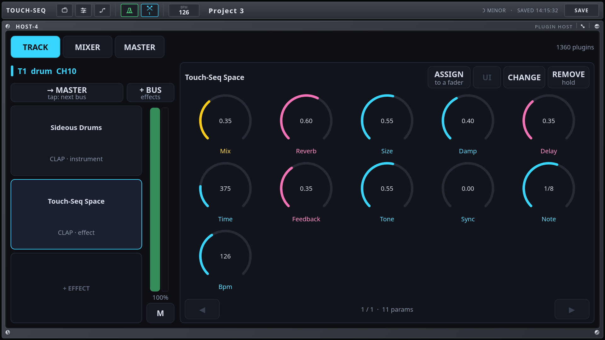 | 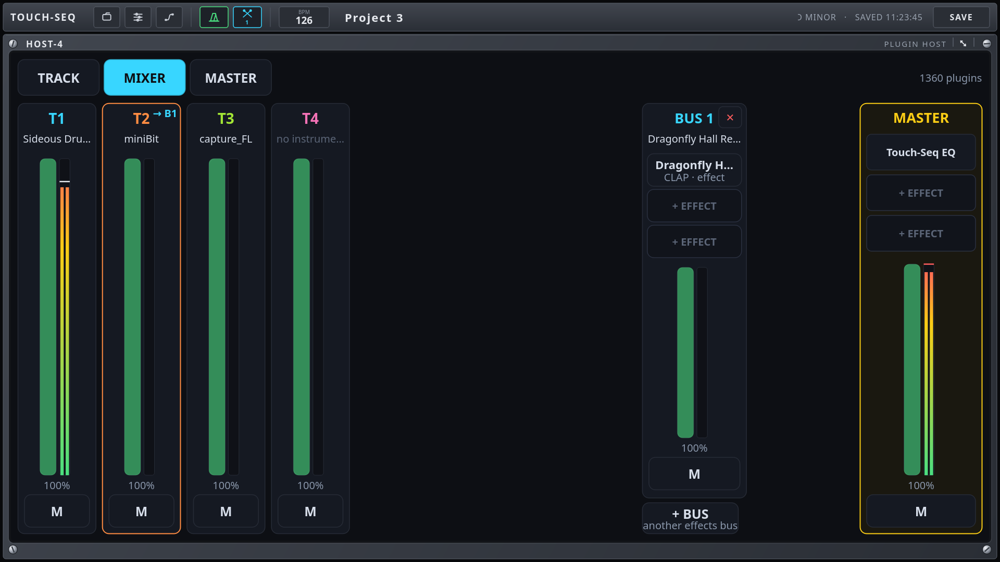 |
| 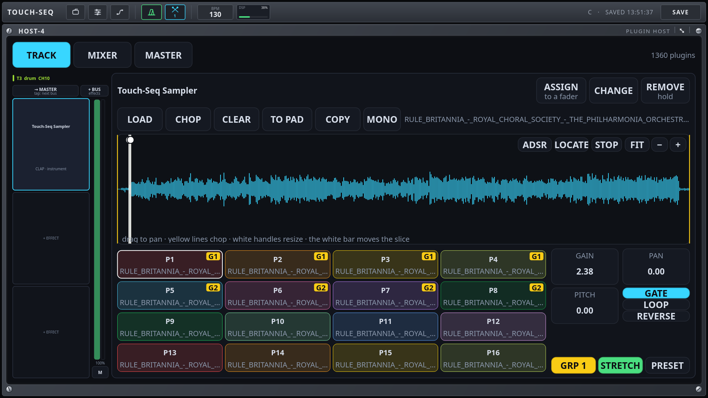 | 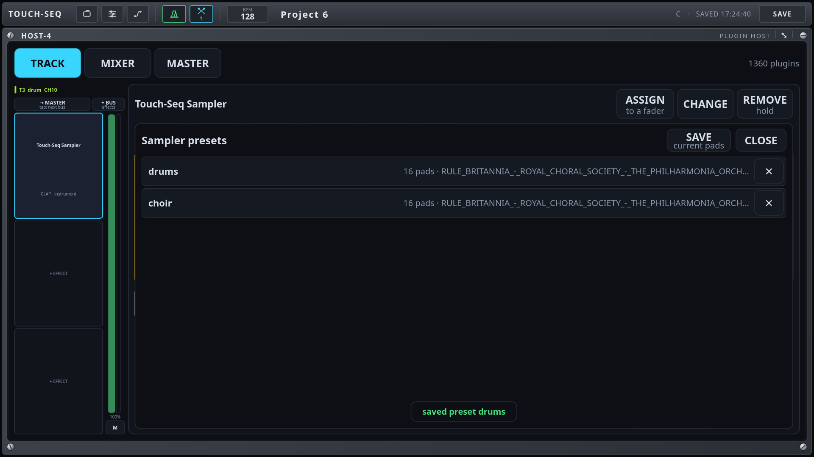 |
| 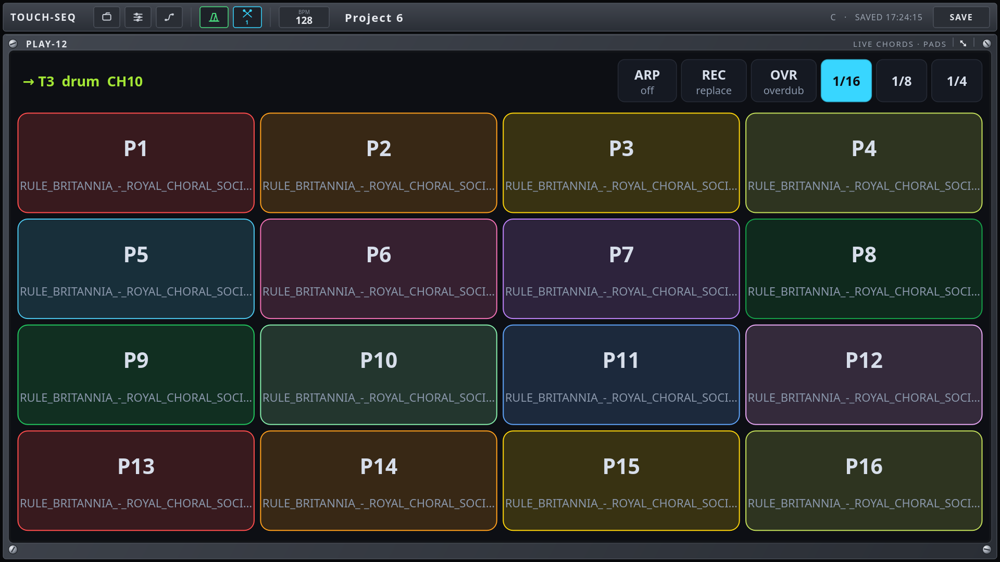 | 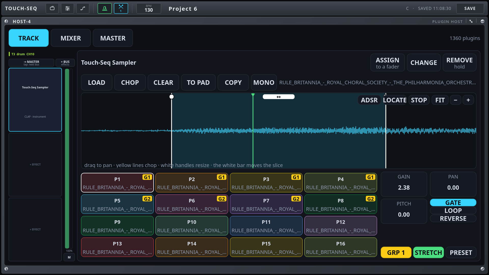 |
| 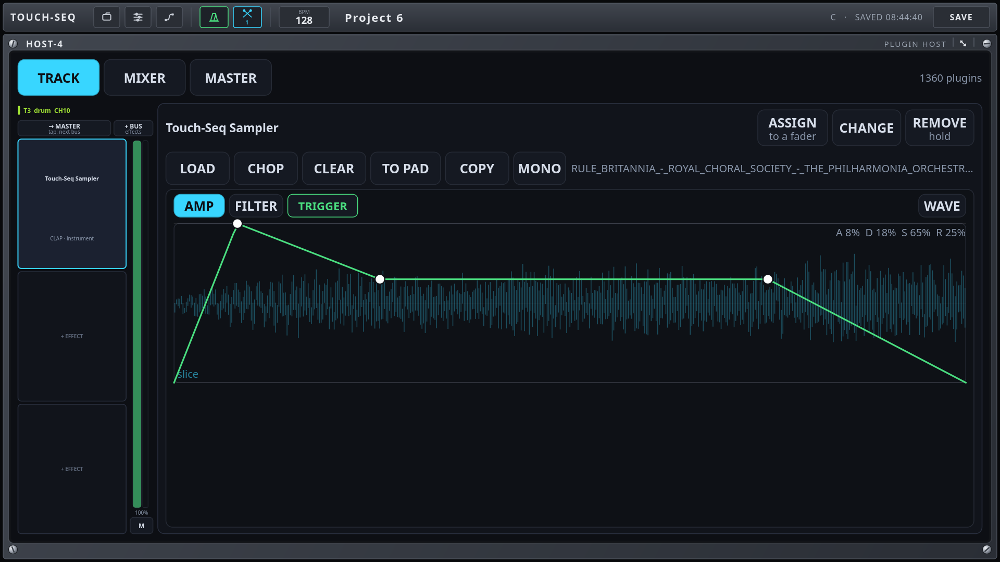 | 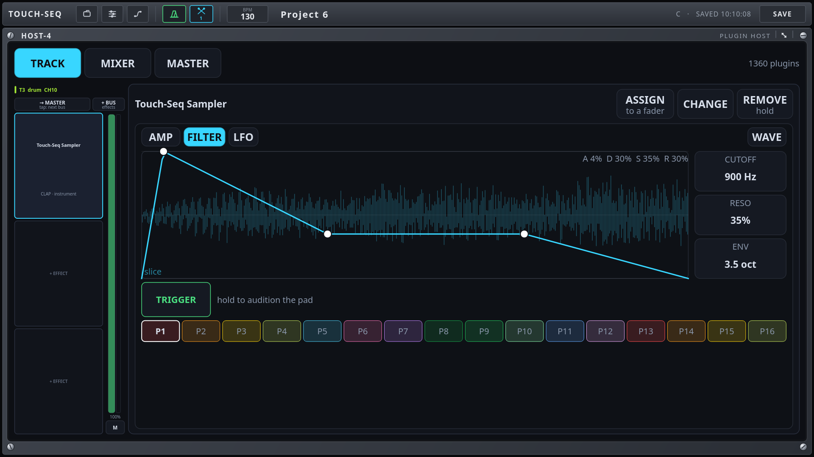 |
| 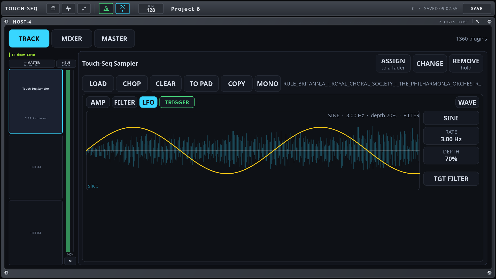 | |
| 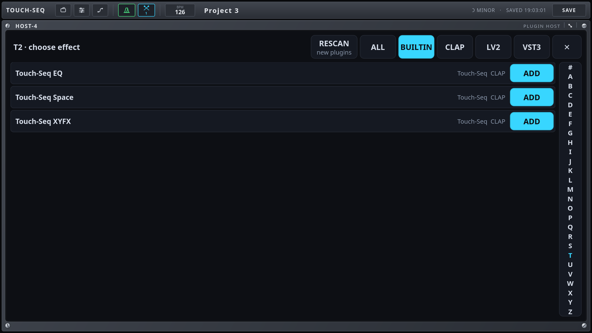 | |
| 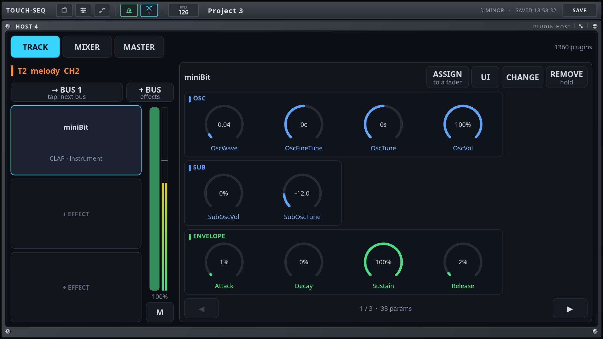 | 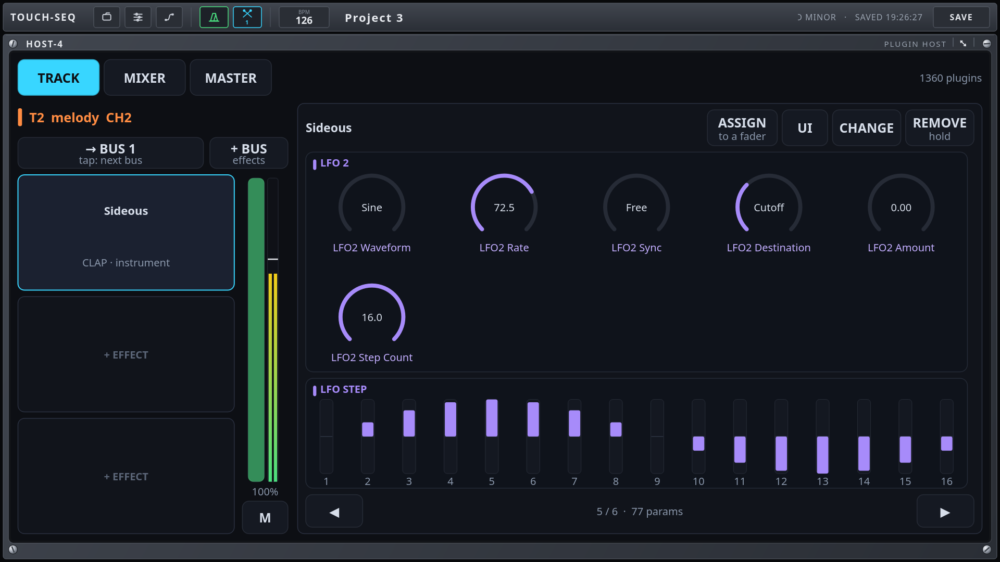 |

### PLAY-12 — live play

Plays the track selected in the sequencer:

- melody tracks: **chord pads** in the project's key (7 diatonic chords colored by function + 5 borrowed
  ones), with 7/9/sus2/sus4, strum, octave and **voice leading** (each chord takes the inversion nearest
  the last one), or a **keyboard** (2 octaves in the module, 4 full screen, glissando)
- drum tracks: 12 pads in the voices' colors
- a track whose instrument is the **Sampler**: its 16 pads (notes 36–51) in the drum voices' fixed colors,
  named after the samples and regions in its HOST-4 editor, instead of the chords or keyboard. On a drum track
  they play but only the pads that match a kit note are recorded (a drum pattern holds voices, not pitches)
- external MIDI tracks: like melody tracks (chords, keyboard), straight out to their output port
- **REC** (replaces the steps you play over) or **OVR** (overdub: leaves them and adds) records what you play
  into the pattern, quantized to 1/16, 1/8 or 1/4 — fingers on the pads and notes from a track's MIDI keyboard
  alike; REC only touches the steps you play, so a pass with nothing played leaves the pattern as it was. What
  you record is **heard at once**: while you hold it the pattern leaves that step to your fingers, and when you
  lift them it plays from there — a bar-long chord keeps ringing into the loop instead of waiting for the next
  pass
- **CLICK** and **COUNT** in the top bar: a tick on every beat (higher on the bar's first) while playing, and
  0/1/2 bars of them before the pattern starts, so you can come in on time
- **ARP** in the header turns the track's arpeggiator on (it lights green, with its rate underneath): the
  chord the track hears — the pads, the keyboard, its MIDI input or a chord held in the pattern — is played one
  note at a time on the **transport's grid**, so the notes sit with the pattern instead of drifting from the
  moment a key went down (with the transport stopped it runs on its own clock, at the project's tempo, so a
  chord can be arpeggiated before pressing play). Its dialog sets **RATE** (1/32 … 1/4, triplets), **MODE**
  (up, down, up-down, random, as played), **1/2/3 OCT**, **GATE** and **LATCH**, and shows what a held C-E-G
  will play. It is **non-destructive**: nothing is recorded, the pattern keeps its chords, and switching it
  off plays them again
- with **XYFX** on the master, a **MASTER** row appears in the sequencer; selecting it turns this module
  into an **XY pad**: beat repeat left–right (straight on the right half, triplets or reverse on the left),
  low-pass down / high-pass up, the centre is "dry"

| | |
|---|---|
| 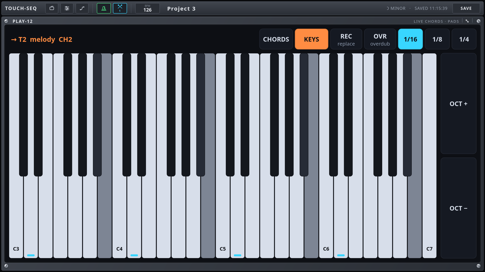 | 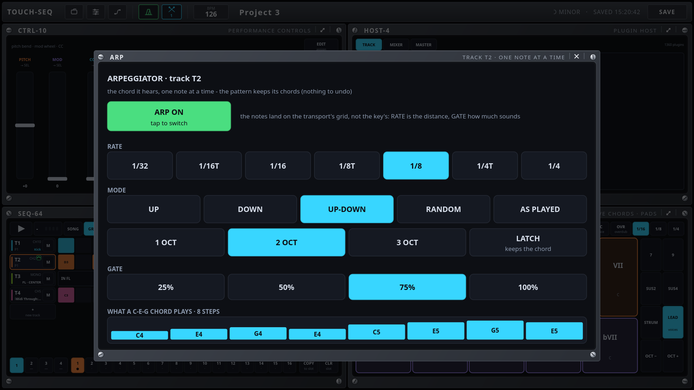 |
|  | 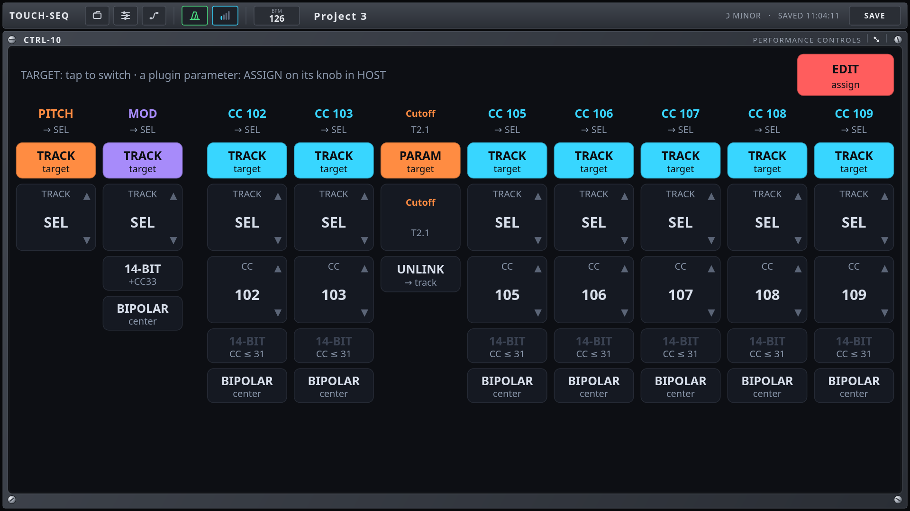 |

### CTRL-10 — performance faders

Pitch bend (springs back), mod wheel and 8 CC faders. Each fader has a **target**:

- **TRACK** — that track's instrument, on its channel; **SEL** = whichever track is selected
- **CHANNEL** — plain MIDI on a channel (outboard gear on the MIDI port)
- **PARAM** — a plugin parameter directly, no MIDI learn needed: **ASSIGN** at the top of HOST-4 puts its
  knobs into a choice mode, tap the knob you want, then tap the fader — fader and knob then move together
  (tap ASSIGN again to cancel, or CANCEL in the fader list)

Optional 14-bit (MSB/LSB pairs) and bipolar faders.

### Projects and settings

FILE lists projects, newest first (open, NEW, DUPLICATE, hold DELETE); NEW asks for the project's name on an
on-screen keyboard first. Switching restarts the app with the
other project. SETTINGS sets the project's key and scale (chord pads, piano roll), where plugins play, and the
audio graph's **buffer size** (SYSTEM or 64 … 2048 samples): the whole graph follows — plugins included — and
the machine's own size comes back when the app closes.

| | |
|---|---|
| 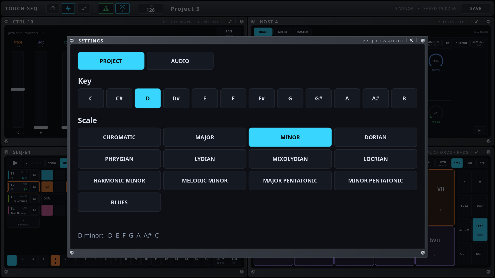 | 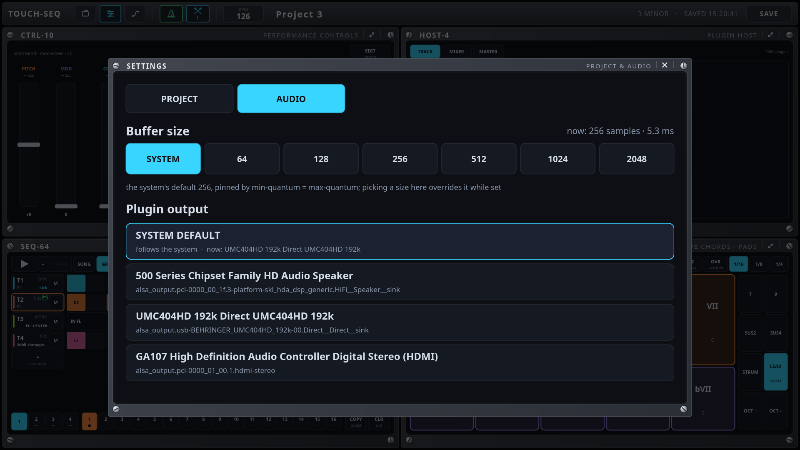 |

### PATCHBAY — audio routing

Every audio port of the machine, grouped by the device or plugin it belongs to: sources on the left,
destinations on the right, and a **cable** drawn for every link between the two. Tap a port and then one on
the other side to patch them, the same pair again to cut it — one source stays chosen, so a 4-channel input is
patched with a tap per channel. That is how a synth plugged into an interface's input is heard through that
interface's output, sent through a bus' reverb, or how a plugin's output is sent to another device. Cables are
drawn for the ports on screen; the links you make here are kept with this machine (config.json, not the
project) and re-made when a device comes back. The rack's own cables — an interface input into its audio
track, a chain into its bus and the master, everything into the output — are thin and solid, cables another
program made are dashed, and neither is yours to cut here.

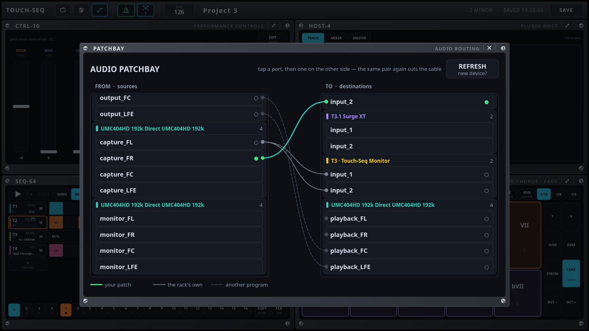

## Install

Download the AppImage for your machine from [Releases](https://github.com/marcin-koziol/touch-seq/releases),
then:

```sh
chmod +x Touch-Seq-0.12.0-x86_64.AppImage
./Touch-Seq-0.12.0-x86_64.AppImage
```

It contains Python, Qt (PySide6), Carla and Touch-Seq's own plugins (XYFX, Monitor, EQ, Click, Space,
Acid and Sampler).
The machine needs:

- Linux, x86_64 or aarch64 (e.g. Raspberry Pi 4/5 with a 64-bit OS), glibc 2.35 or newer
  (Ubuntu 22.04+, Debian 12+, Fedora 36+, Arch, Raspberry Pi OS bookworm)
- **PipeWire** with its JACK support (`pipewire-jack`) and the `pw-link` tool — the plugin host runs on
  JACK and wires plugins with `pw-link`. Without them the sequencer, pads and faders still work over MIDI;
  HOST-4 just says it's unavailable.
- your plugins in the usual places (`~/.clap`, `~/.lv2`, `~/.vst3`, `/usr/lib/…`); the first start scans
  them in the background (a minute or two), later starts use the cache — **RESCAN** in the plugin browser
  picks up new ones

Touch-Seq also sends everything to a MIDI port (a virtual "Touch-Seq" port by default) with clock and
start/stop, so it can drive outboard gear or a DAW too. An **external MIDI** track is the other way round: it
sends to its own output (chosen when the track is created, changeable in HOST-4) and to nothing else — if the
device is unplugged its notes are simply not sent, and they come back when it reappears.

## Less obvious things

| where | gesture | does |
|---|---|---|
| everywhere | **hold** (~1 s) on DELETE / REMOVE | destructive actions need a hold |
| module rail | **⤢ / ⤡** | module full screen and back |
| top bar | tap **BPM** | the tempo: drag the number, ±1/5/10, TAP it out |
| sequencer | tap a track header twice | opens it in EDIT |
| SONG | tap a step | plays it from the next bar; its bars / ×repeats change on a tap, ✕ deletes on a hold |
| GRID / SONG | hold a row, then drag | moves a track (GRID) or a step (SONG) to another place in the list |
| EDIT | drag the lane under the roll | draws velocity, gate or a controller lane (a fast drag fills in the ramp); the **▲ / ▼** chevron hides the roll for more room |
| top bar | **CLICK** / **COUNT** | the metronome, and 0/1/2 bars of count-in before the pattern |
| sequencer | drag a **pattern slot** onto another | copies the pattern there and switches to it (at the bar) |
| sequencer | drag along a row | paints steps on/off |
| piano roll | tap empty / tap a note | place / remove; drag a note sideways = length, up/down = pitch |
| piano roll | drag the keyboard on the left | scroll; OCT ▼▲ jumps an octave |
| plugin knobs | drag up/down | turn; to drive one from a CTRL fader, **ASSIGN** in HOST-4 then tap the knob and the fader |
| chord pads | 7 / 9 / SUS while holding a chord | the held chord changes right away |
| PLAY-12 header | **ARP** | the track's arpeggiator: rate, mode, octaves, gate, latch (lights with the rate when on) |
| LEAD | toggle off and on | restarts voice leading from root position |
| XY pad | LATCH | keeps the effect on after the finger lifts |
| keyboard | lower on the key | louder (pads: higher = louder) |
| EDIT header | the **DIN socket** at the left | a track's MIDI keyboard and channel (green = it is there) |

Keys (with a keyboard attached): **Space** play/stop, **Esc** closes a dialog/popup, then quits; **Ctrl+C** quits.

## Configuration

`~/.config/touch-seq/config.json` (created on first start):

| key | meaning |
|---|---|
| `screen` | output to go full screen on, e.g. `HDMI-1`; empty = primary screen |
| `midi_port` | MIDI out: an existing port whose name contains this, otherwise a virtual port of that name |
| `projects` | projects folder (default `~/.local/share/touch-seq/projects`) |
| `audio_out` | `default` (follow PipeWire's default output) or a sink node name — easier set in SETTINGS → AUDIO |
| `patch` | audio links made in PATCHBAY, as `[[out port, in port], …]` — this machine's cables |
| `buffer` | audio buffer size in samples for the whole graph while the app runs, `0` = the system's own |
| `click_lead` | the metronome stream's own delay in ms — only for the fallback without the click plugin |

The metronome is **Touch-Seq Click**, our own plugin (`click/`, CLAP/LV2, like the monitor and the EQ): the
master's audio goes through it and the engine plays it one note per beat, so the click is rendered inside the
same audio graph as the instruments — sample-locked to them, under Carla's care, and with nothing to drift.
Without the plugin installed the app falls back to its own stream (`pw-cat`), which is fine but a buffer
behind; `click_lead` shifts that one by hand if a machine needs it.

`buffer` is applied with `clock.force-quantum`, so it wins over a `min-quantum = max-quantum` pin in
`pipewire.conf.d` (such a pin is why a size may look stuck in the settings); the machine's own size is put
back when the app closes.

Projects save themselves (every couple of seconds while editing, and on exit); plugin states are saved next
to each project in `<name>.plugins/`. Our own plugins (XYFX, Space, EQ, Click, Acid, Sampler) also get a
`.params.json` beside the state, because they keep their parameters out of it — a knob turned in HOST-4 is saved on that same
couple-of-seconds clock. A third-party plugin's state is left to speak for itself, so a preset chosen in its
own UI is not overwritten by an old sidecar; a change the plugin makes itself (a preset, its own knob) also
marks the state for saving, so it survives a project switch without waiting for the 30 s clock.

**Touchscreen on a multi-monitor GNOME/Wayland desktop:** tell Mutter which monitor the touch panel belongs
to — the touch device's vendor:product from `lsusb`, the monitor's vendor/product/serial from
`gdbus call --session --dest org.gnome.Mutter.DisplayConfig --object-path /org/gnome/Mutter/DisplayConfig --method org.gnome.Mutter.DisplayConfig.GetCurrentState`:

```sh
gsettings set org.gnome.desktop.peripherals.touchscreen:/org/gnome/desktop/peripherals/touchscreens/0eef:c000/ \
  output "['IVM', 'PLT2215      ', '0x0000007d']"
```

Raw touch events can be logged with `TOUCHSEQ_TOUCH_LOG=touch.log` to debug a touch panel.
Parameter writes and plugin-state saves can be logged with `TOUCHSEQ_PARAM_LOG=params.log`, which says what
Touch-Seq wrote, to which plugin, and from where (a knob, a fader, the tempo follow, a state restore).

## Running from source

```sh
git clone --recursive https://github.com/marcin-koziol/touch-seq.git && cd touch-seq
python3 -m venv .venv && .venv/bin/pip install -r packaging/requirements.txt
.venv/bin/python touchseq.py
```

The plugin host needs Carla **with CLAP support**, which released Carla (2.5.x) doesn't have yet: install a
git build (e.g. `carla-git` on Arch) or build the engine with `packaging/build-carla.sh ~/carla-touchseq`
and run with `CARLA_PREFIX=~/carla-touchseq`. A `config.json` next to `touchseq.py` takes precedence over
the one in `~/.config` (handy for development).

## Under the hood

**Touch-Seq is not a DAW wearing a touchscreen.** It is a MIDI brain and a UI around Carla's audio graph: no
audio buffers of its own (the EQ reads its spectrum through the plugin's output parameters), no plugin
format layer of its own (Carla has it), and no floating windows in the way (HOST-4 draws the parameters).

- `touchseq.py` is the entry point: it flattens the package back into one namespace, so `import touchseq as ts`
  in the tests sees everything. The app is `tseq/`, one module per concern: `model` (the project and its
  files), `engine` (MIDI out and the playback thread), `ui` (the drawing toolkit, `Panel` and the module
  window), one module per rack panel (`sequencer`, `controls`, `host`, `performer`), then `patchbay` (audio
  routing), `rack`, `dialogs` and `app` (startup). `tseq/__init__.py` lists them in dependency order; nothing
  in the package imports anything above it.
- the **engine** runs one thread with a lock: 24 PPQN, notes scheduled with wall-clock deadlines (so a note
  keeps its gate over the bar line), controller lanes sent every tick, the arpeggiator on the same grid. UI
  changes that touch playback state take that lock too.
- the **UI is immediate mode**: panels paint themselves in their own coordinates and collect hit regions while
  drawing, so a module is a `draw()` plus gestures — nothing to keep in sync, nothing to leak when a track goes.
- **projects are JSON** (+ a plugin-state folder), autosaved every couple of seconds and on exit.

### The plugins that ship with it

The plugins in this repo are the app's own: **XYFX** (MPC-style beat repeat + filter, also the master's
XY pad), **EQ** (eight bands, drawn in the app), **Space** (delay + reverb), **Acid** (303-style bass),
**Sampler** (16-pad MPC-style), and the two the app puts in place itself — **Monitor** (a transparent
gain/pan) and **Click** (the metronome). All are CLAP + LV2, built with
[DPF](https://github.com/DISTRHO/DPF), and installed with their own script:

```sh
xyfx/install.sh monitor/install.sh eq/install.sh click/install.sh space/install.sh acid/install.sh sampler/install.sh
# into ~/.clap and ~/.lv2
```

The XYFX can also be used outside Touch-Seq (in a DAW, or any plugin host): releases carry
`touchseq-xyfx-*.tar.gz`, and its parameters (Engage, X, Y, BPM, Mode) can be automated from any host.
The app is GPL-3.0-or-later; our plugins are ISC licensed, except **Acid**, which is GPL-3.0-or-later: it
includes the MIT-licensed **Open303** engine (Copyright (c) 2009 Robin Schmidt, `acid/open303/LICENSE`) and
the GPL-3.0 GuitarML BYOD overdrive from jc303 (`acid/overdrive/LICENSE`). RTNeural is BSD-3
(`acid/rtneural/LICENSE`).

### Tests and builds

```sh
QT_QPA_PLATFORM=offscreen python tests/test_app.py   # sequencer, UI, projects, live play, arp: no audio (CI)
QT_QPA_PLATFORM=offscreen python tests/test_host.py  # plugin host with real Carla + PipeWire (local only)
QT_QPA_PLATFORM=offscreen python tests/test_xyfx.py  # XYFX + XY pad with real Carla (local only)
packaging/build-appimage.sh                          # dist/Touch-Seq-<version>-<arch>.AppImage
```

CI runs the app tests and every plugin's DSP test on each push; a `v*` tag builds AppImages for x86_64 and
aarch64 and publishes a release (with Carla's source attached, as its GPL requires).

## License

Touch-Seq is GPL-3.0-or-later ([LICENSE](LICENSE)). XYFX is ISC ([xyfx/LICENSE](xyfx/LICENSE)). The AppImage
bundles Carla (GPL-2.0-or-later, built from a pinned git commit; its source is attached to each release),
PySide6/Qt (LGPL-3.0) and python-rtmidi (MIT).
